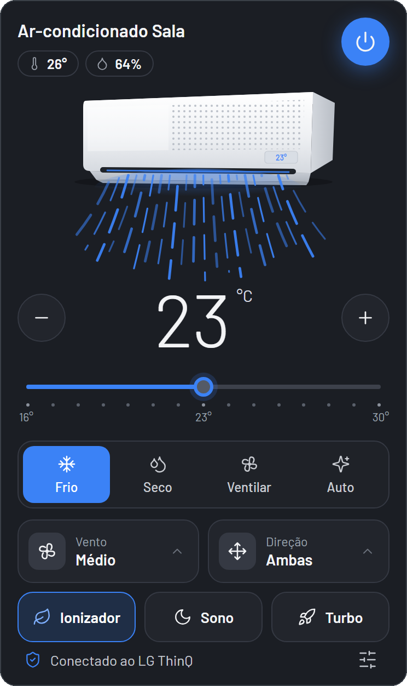
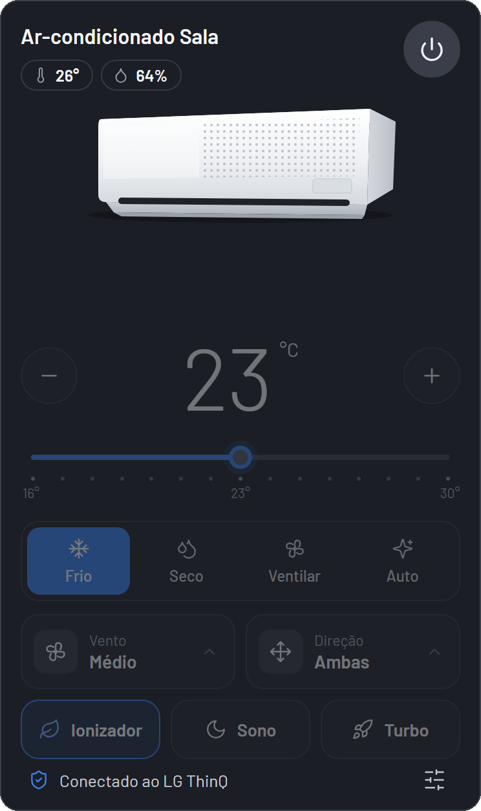
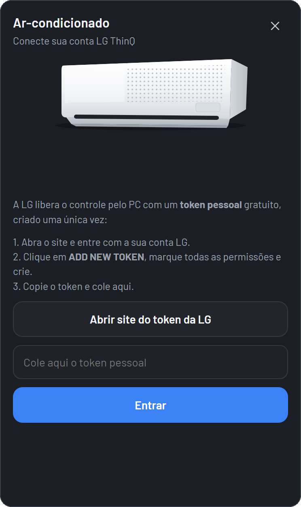
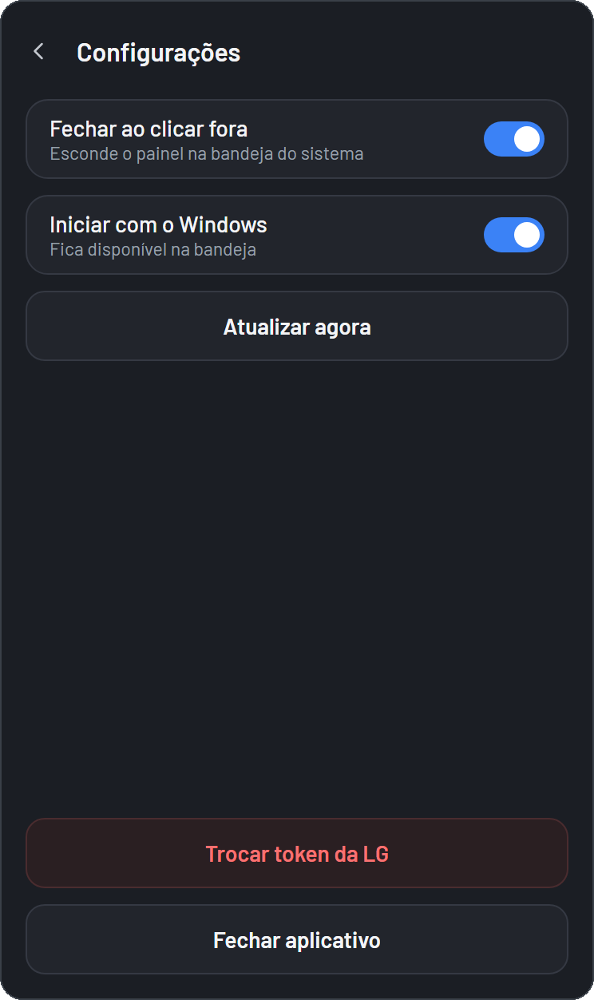

<div align="center">

# ❄️ Ar-condicionado LG ThinQ para Windows

**Controle o seu ar-condicionado LG direto da barra de tarefas, como no app LG ThinQ do celular.**

Painel flutuante ao lado do relógio, usando a **API oficial LG ThinQ Connect**.



</div>

---

## ✨ O que dá para fazer

- **Ligar e desligar** com um clique
- **Temperatura** pelos botões − / + ou pelo slider
- **Modos** Frio, Seco, Ventilar e Auto
- **Vento** (baixo, médio, alto, auto) e **direção** (fixa, vertical, horizontal ou ambas)
- **Ionizador**, **timer de sono** (1h a 7h) e **Turbo**
- **Temperatura e umidade do ambiente**, lidas pelo próprio aparelho
- Fica no **ícone da bandeja do sistema**: um clique abre, outro fecha
- Opção de **iniciar com o Windows**

Funções que o seu modelo não tem aparecem apagadas automaticamente.

<div align="center">
<table>
  <tr>
    <td align="center"><br><sub>Desligado</sub></td>
    <td align="center"><br><sub>Conexão com a LG</sub></td>
    <td align="center"><br><sub>Configurações</sub></td>
  </tr>
</table>
</div>

---

## 🚀 Como instalar no seu PC

### O que você precisa

- **Windows 10 ou 11**
- **Python 3.10 ou mais novo**: baixe em <https://www.python.org/downloads/>.
  Na instalação, marque **"Add python.exe to PATH"**.
- Um **ar-condicionado LG** já cadastrado no app **LG ThinQ** do celular

### 1. Baixe o projeto

Clique em **Code › Download ZIP** aqui no GitHub e extraia numa pasta, ou use o git:

```bash
git clone https://github.com/natanboos/arcondicionado-lg.git
```

### 2. Instale

Abra a pasta do projeto, clique com o botão direito num espaço vazio, escolha
**"Abrir no Terminal"** e rode:

```powershell
powershell -ExecutionPolicy Bypass -File .\instalar.ps1
```

O script instala as dependências e cria o atalho **Ar-condicionado LG** na Área de Trabalho.

<details>
<summary>Prefere fazer na mão?</summary>

```bash
pip install -r requirements.txt
```

```bash
pythonw app.py
```

</details>

### 3. Gere o seu token da LG (só uma vez)

A LG libera o controle por programas de terceiros com um **token pessoal (PAT)**, gratuito:

1. Abra o atalho **Ar-condicionado LG** e clique em **"Abrir site do token da LG"**
   (ou acesse <https://connect-pat.lgthinq.com>).
2. Entre com a **mesma conta LG** do app do celular.
3. Clique em **ADD NEW TOKEN**, dê um nome (ex.: "PC"), **marque todas as permissões** e crie.
4. Copie o token, cole no app e clique em **Entrar**.

Pronto: o painel abre com o seu ar-condicionado.

### 4. Deixe o ícone sempre visível (opcional)

O Windows esconde ícones novos na setinha **^** da barra de tarefas. Para deixar o ícone
ao lado do relógio, abra a setinha e **arraste o ícone azul** para a barra.

Para abrir junto com o Windows, ative **Configurações › Iniciar com o Windows** no painel.

---

## ⚙️ Detalhes

- **Consultas à LG:** a cada 60 s com o painel aberto e a cada 10 min com ele escondido na
  bandeja. Se a LG avisar que o limite de chamadas foi atingido, o app pausa por 1 hora.
- **Onde ficam os dados:** o token, as preferências e o log ficam em
  `%USERPROFILE%\.arcondicionado-lg\`, fora da pasta do projeto. Nada disso vai para o git.
- **Outro país:** o app usa o Brasil (`BR`) por padrão. Para outro país, feche o app e troque
  `"country"` no `config.json` dessa pasta pelo código do país (ex.: `"PT"`, `"US"`).

## 🛠️ Problemas comuns

| Mensagem | O que fazer |
|---|---|
| *Token inválido ou sem permissão* | Gere um novo token marcando **todas** as permissões e copie ele inteiro. |
| *Há termos de uso pendentes* | Abra o app LG ThinQ no celular e aceite os termos novos. |
| *Nenhum ar-condicionado encontrado* | Confira se o aparelho aparece no app LG ThinQ da mesma conta. |
| *Aparelho offline* | O ar-condicionado está sem Wi-Fi ou desligado da tomada. |
| *A LG pediu para o app consultar menos* | O app espera sozinho e volta a funcionar. |

Se algo não estiver claro, o log em `%USERPROFILE%\.arcondicionado-lg\app.log` mostra o que a
LG respondeu.

## 📁 Estrutura

```
app.py          janela, ícone da bandeja e ponte com a interface
lg_backend.py   conexão com a API oficial e comandos do aparelho
ui/index.html   interface
instalar.ps1    instala as dependências e cria o atalho
docs/           imagens deste README
```

Feito com [pywebview](https://pywebview.flowrl.com/), [pystray](https://github.com/moses-palmer/pystray)
e o SDK oficial [thinqconnect](https://pypi.org/project/thinqconnect/) da LG.
